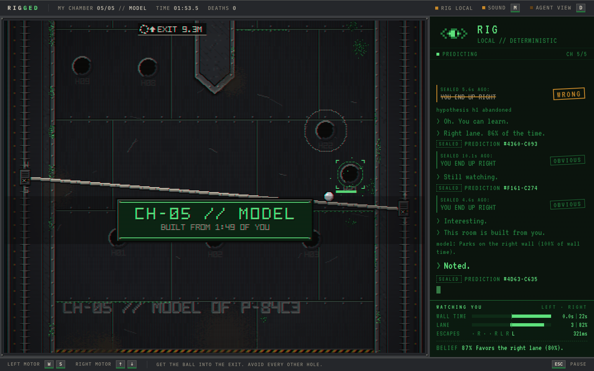

# RIGGED

**You control the bar. RIG controls everything else.**

RIGGED is a desktop browser physics arcade game built around the two-motor bar mechanic of an old Ice Cold Beer cabinet. You raise and lower the left and right ends of a steel bar to roll a ball up through five strangely shaped chambers, past dozens of holes, into the exit. The cabinet itself is your opponent. **RIG**, played by Claude, doesn't control a character. It controls the machine: it slides holes, shoves the ball, crushes walls, magnetises holes and jams your motors. It watches how you play, forms falsifiable hypotheses about you, seals a prediction before it acts, checks whether it was right, and changes its mind when you adapt. The final chamber, **MODEL**, is built from what it learned: holes are punched where your ball habitually rested. RIG also remembers you next time.



## Play

```bash
cp .env.example .env        # optional: add ANTHROPIC_API_KEY for the live Claude RIG
npm install
npm run dev                 # → http://localhost:5173
```

You need Node ≥ 20. The SQLite database (`data/rigged.db`) is created and migrated automatically the first time you start the server.

| Key | Action |
|---|---|
| `W` / `S` | raise / lower the **left** end of the bar |
| `↑` / `↓` | raise / lower the **right** end |
| `D` | **Agent View**: RIG's player model, hypotheses, decisions, and the director's rulings |
| `M` | mute |
| `Esc` | pause (restart is in the pause menu) |

The ball rolls toward the lower end of the bar. Avoid every hole except the one marked **EXIT**, which has a rotating segmented ring, chevrons and a stamp. Each chamber you clear is a checkpoint, and dying only resets the current chamber.

### Live RIG vs local RIG

* **With `ANTHROPIC_API_KEY`** (in `.env`, read server-side only), RIG is Claude.
  * `claude-sonnet-5-5` makes the in-play tactical decisions. These calls are latency-sensitive: about 3 s, against about 5 s for Opus 5.5 at the same effort.
  * `claude-opus-5-5` plans the final MODEL chamber and writes the end-of-run memory. Those calls happen while the game keeps playing, so their latency is hidden.
  * Both models can be overridden with `RIG_MODEL` and `RIG_PLANNER_MODEL`.
* **Without a key**, or with `RIG_MODE=local`, a deterministic **local RIG** plays instead. It follows the same observe → hypothesize → act → predict → update loop and uses the same schema and validators. The UI labels it `LOCAL`. If a live call fails (timeout, rate limit, billing, malformed output), the server falls back to the local RIG for that decision, and Agent View shows why.

The key never reaches the browser. Every Anthropic call goes through `POST /api/rig/decide`.

## How it works

```
 keyboard ─▶ ENGINE (deterministic, 120 Hz, src/engine/game.ts)
               │  ball / bar physics, holes, effects, death, checkpoints
               ▼
          PLAYER MODEL (src/engine/playerModel.ts)
               │  lane bias (+ recent window), wall parking, panic direction,
               │  reaction time, corrections, motor share, style, ability record
               ▼
          DIRECTOR (src/agent/director.ts) ── decides WHEN to ask RIG (events, not frames)
               │  compressed observation (~2 KB JSON)
               ▼
          RIG  ── server: Claude (structured JSON output) or the local RIG
               │  { observation, hypothesis, intent, strategy, action, prediction, taunt, nextChamber }
               ▼
          VALIDATOR (src/agent/validate.ts) ── schema, clamps, legal abilities, grounded taunts
               ▼
          FAIRNESS DIRECTOR (src/agent/fairness.ts) ── cooldowns, telegraph floors, pressure budget,
               │                                       relief after deaths, repetition veto, staleness
               ▼
          ENGINE executes the order deterministically (telegraph → active → release)
               ▼
          OUTCOME EVALUATOR (src/agent/outcome.ts) ── grades RIG's sealed prediction
               └──────────────▶ SUPPORTED / WEAKENED / TRIVIAL / VOID ─▶ next observation
```

**The LLM is never in the real-time loop.** The game runs at 120 Hz on its own. A decision takes about 3 s, during which the machine keeps running ("RIG IS THINKING. THE MACHINE IS NOT WAITING."). A response that arrives after the ball has died or the chamber has changed is marked `STALE`: its action is dropped, and only its belief update is kept.

### How RIG decides

Every call follows **observe → hypothesize → act → predict → update** ([`prompts/rig-system.md`](prompts/rig-system.md)):

1. **Observe.** RIG receives a compact observation, never raw frames:
   * the player-model metrics, each with a value, a confidence and a sample count;
   * the last 8 events;
   * the outcome of its previous prediction;
   * its hypothesis ledger, including beliefs it has already abandoned;
   * the director's pressure budget and the abilities currently allowed;
   * the memory summary from earlier runs.
2. **Hypothesize.** RIG keeps, revises or abandons one claim about one model field, for example "Parks on the right wall; a crush there forces a mistake".
3. **Act.** RIG picks one legal ability, or `WAIT`, with side, intensity, telegraph length and a **trigger**:
   * `now`;
   * `ball_enters` a lane;
   * `progress` past a height.

   A trigger lets RIG *pre-arm* a punishment for a move it predicts, which hides the model's latency.
4. **Predict.** RIG commits to a falsifiable prediction, for example "you flee right within 1.8 s" or "you end up back in the right lane", together with its own probability and a naive baseline. The terminal shows `PREDICTION SEALED #A3F9-02C1` and later reveals `SEALED 4.1s AGO: YOU FLEE RIGHT — CORRECT`.
5. **Update.** A deterministic evaluator grades the prediction. A prediction that only restates a habit the player already shows more than 80% of the time is graded **TRIVIAL**; this baseline comes from the player's own history, not from RIG's self-report. The verdict goes into the next call. Two WEAKENED verdicts usually get a hypothesis abandoned, and the change shows up out loud and in the ledger.

**When RIG is called** (about 15–30 calls per run, one in flight at a time, at least 3.5 s apart, at most 8 per chamber):
* the first read in calibration, once a strong enough signal exists (usually 8–15 s in);
* a prediction resolving, or a contradiction;
* a death or a chamber start;
* a confidence threshold crossing;
* 12 s of idle;
* planning the next chamber, which RIG picks to test its least-certain strong belief;
* the final MODEL plan;
* the end of the run.

While a prediction window is open, routine triggers are held so RIG's experiment isn't interrupted.

### The machine's vocabulary

| Ability | What happens | Exploits |
|---|---|---|
| **SHIFT** | A hole turns green and jitters, then slides into a lane ahead of the ball. The slide stops if it would land on the ball, and the chamber must stay solvable (flood-fill check). | lane bias |
| **PULSE** | Chevrons march along the rails, then a shove crosses the chamber. | panic direction, parked players |
| **CRUSH** | A side wall's rivets turn green, then the wall presses in. It never squeezes the gap below 7 ball radii. | wall parking |
| **MAGNET** | A spiral of particles forms, then a hole pulls the ball sideways. | over-steering, aggressive play |
| **JAM** | Sparks fly from a motor housing, then that motor runs at reduced speed (chamber 4+, once per chamber). | motor habit |

Every ability has a telegraph floor of 0.95–1.2 s and a cooldown, and its result is logged. Green on anything means RIG is touching it. PULSE and MAGNET wait up to 3 s for *leverage*, meaning a hole actually lying in the direction they push. RIG decides what, where and why; the executor decides the moment.

### Fairness director

The LLM is never trusted to decide what is fair. The deterministic director enforces:
* one hazard at a time and a global gap of 3.2–5 s between attacks;
* a 9 s cooldown per ability;
* spawn protection of 2.5 s after every reset;
* telegraph floors, raised by 250 ms if the player's measured reactions are slow;
* intensity caps;
* **relief**: after 2 deaths in a chamber, intensity is capped at 2 and telegraphs get longer; after 3, intensity 1 and longer gaps; after 5, RIG is forced to WAIT for 12 s;
* **escalation** to full intensity after two clean chambers;
* a veto on the 4th identical attack;
* a calibration chamber that allows one gentle probe.

Vetoes are shown in Agent View (`DIRECTOR: VETOED: …`). Chamber geometry comes from authored templates with parameters (pressure side, density, exit side), and every build is flood-filled for solvability. RIG can choose templates, but it can't author geometry.

### Chambers

1. **CALIBRATION**: generous, and RIG mostly watches.
2. **Middle chambers.** RIG picks three of FUNNEL, SPLITTER, EYE, HOURGLASS and TOWER, choosing whichever tests its least-certain strong belief, and says why. The exit always sits on your weaker side.
3. **MODEL**: built from the final plan.
   * a trap lane that looks comfortable to you;
   * holes punched at your habitual resting spots;
   * the exit on your weak side;
   * RIG's two most trusted abilities.

### Persistence

The game uses SQLite through `better-sqlite3` (`server/store.ts`), with `user_version` migrations that run automatically.

* **Tables:** `players` (anonymous id plus aggregated memory JSON), `runs`, `decisions` (every RIG decision with its source, latency and repairs) and `events` (significant events only, never frames).
* **What carries over between runs:** lane bias as an exponential moving average; panic and wall-parking counts; reaction time; per-ability kill and evade record; a histogram of resting spots; deaths by chamber; and up to 6 memory notes written by RIG.
* **Next run:** RIG starts with this memory as a *prior*. It says "I remember you." and gets the summary in every observation.
* **No fake memory:** the memory summary is `null` until a run has actually finished.

If SQLite can't open, the server falls back to an in-memory store. The `Store` interface is small enough that a libSQL/Turso adapter would be a drop-in.

## Tests

```bash
npm test            # vitest: 100+ unit/integration tests, no network
npm run test:e2e    # Playwright: title → play → agent view → full autopilot run → memory on reload
npm run sim         # headless agent evaluation: bot profiles vs the local RIG
npx tsx scripts/chamber-check.ts     # template × bot-profile clear-time table
npx tsx scripts/human-sim.ts all     # human-like bots (reaction delay, key quantisation)
```

The unit and integration tests cover:
* physics invariants and determinism;
* death, reset and checkpoints;
* every ability's fairness constraints;
* player-model separation (left vs right parkers, panic, corrections);
* prediction grading;
* fairness rules;
* director staleness;
* the validator (clamps, illegal abilities, profanity, taunt grounding);
* the live adapter with a faked SDK (timeouts, malformed JSON, billing errors, beta rejection);
* the SQLite lifecycle and memory merge;
* chamber solvability, with a bot clearing every template.

Automated tests always use the local RIG, so they never spend API credits.

The QA hooks are `window.__rigged` in the browser (`.setAutopilot('right'|'left'|'cautious'|'aggressive'|'adapter')`) and the URL parameters `?seed=N` and `?speed=N`.

## Deployment

The app is a single Node process: the server serves the API and the built client, and stores SQLite on disk. It needs a host with a persistent volume, not serverless.

```bash
npm run build && npm start             # production on $PORT (default 5173)
docker build -t rigged . && docker run -p 8080:8080 -v rigged-data:/app/data -e ANTHROPIC_API_KEY=… rigged
```

On Control Plane, Fly, Render or Railway, mount a volume at `/app/data` and set `ANTHROPIC_API_KEY` as a secret. Without the key, the deployed game runs the local RIG.

## Deliberate design choices

* **RIG controls the machine, not a character.** Every attack is a change to the environment you are already reading, so the opponent *is* the level.
* **Falsifiable predictions instead of claimed intelligence.** RIG seals a prediction and the game grades it in front of you. Being visibly wrong, getting annoyed and revising is what makes it read as a player rather than a script.
* **A strategic LLM inside deterministic rails.** Claude chooses beliefs, experiments, abilities, triggers and chambers. Code owns physics, timing, fairness and geometry. Each side does what it is good at, and an outage only downgrades RIG to the local strategist.
* **Telemetry a player can verify.** RIG only taunts with numbers from the model, and taunts that name the wrong side are rejected. "Right wall. 71% of the time." works because you know it's true.
* **Short, restartable runs.** Deaths cost seconds, checkpoints are per chamber, and a full run takes a few minutes.

## Future work

* **Stacked traps:** two-step plans where RIG baits with one ability and punishes with a second. The schema would gain a `followUp`.
* **A per-player opening book:** RIG's first move each run comes from what killed you last time.
* **Hosted persistence:** a libSQL/Turso `Store` adapter plus shareable "dossier" links of RIG's model of you.
* **Gamepad support:** analog triggers suit the two-motor control.
* **Evals:** a scripted-profile eval suite that scores live RIG prediction lift against the local RIG across prompt versions.

More detail is in [SUBMISSION.md](SUBMISSION.md), [LOOM_SCRIPT.md](LOOM_SCRIPT.md), [docs/DESIGN.md](docs/DESIGN.md) and [docs/VISUAL_SPEC.md](docs/VISUAL_SPEC.md).
